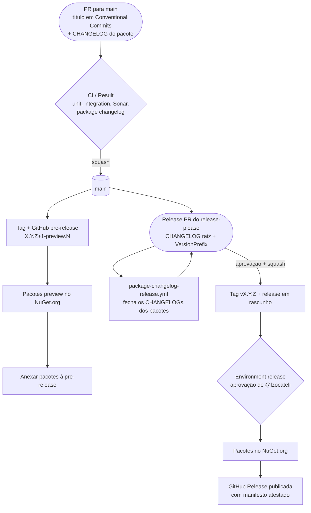

# Processo de release

O Nuuvify.CommonPack usa o processo único de CI/CD distribuído pelo
[Altivy.Groundwork](https://github.com/altivy-it/altivy-groundwork): Conventional Commits,
Release PR do release-please, tag única `vX.Y.Z` criada pelo GitHub App de release e publicação
no Environment `release`. O passo a passo genérico está em
[docs/runbooks/release.md](../runbooks/release.md) e os workflows em
[.github/CI-CD.md](../../.github/CI-CD.md). Este documento descreve apenas o que é específico
deste repositório: versão compartilhada, canais de publicação e CHANGELOG por pacote.

## Visão geral



## Versão compartilhada

- Os pacotes compartilham uma única versão: `VersionPrefix` em
  [src/Directory.Build.props](../../src/Directory.Build.props). Nunca altere esse valor à mão:
  o release-please atualiza o arquivo e o `.release-please-manifest.json` no Release PR.
- `AssemblyVersion` continua `Major.0.0.0` e `FileVersion` recebe a revisão do build.
- O tipo do título do PR define o incremento: `feat` → minor; `fix`, `perf`, `revert` e `deps`
  → patch; `!` ou rodapé `BREAKING CHANGE:` → major. Os demais tipos não geram release.

## Canais de publicação

| Canal | Quando | Versão | Destino | Environment |
| --- | --- | --- | --- | --- |
| Snapshot | Cada push na `main` (job `Snapshot` do CI) | `X.Y.(Z+1)-preview.N` | NuGet.org e GitHub pre-release | `preview` |
| Preview de rascunho | Disparo manual do CI na `main` para a tag estável em rascunho | `X.Y.Z-preview.N` | NuGet.org e GitHub pre-release | `preview` |
| Estável | Merge do Release PR | `X.Y.Z` | NuGet.org e GitHub Release | `release` (com aprovação) |

- Todos os canais usam Trusted Publishing via OIDC, sem chave permanente. Configure as políticas
  do NuGet.org e a variável `NUGET_USER` conforme o
  [tutorial](./github-manual-setup-tutorial.md#5-configurar-trusted-publishing-no-nugetorg).
  Antes de publicar no NuGet.org, o snapshot cria a tag e publica a GitHub pre-release.
  A criação da tag usa o GitHub App de release, autorizado pelo ruleset `gw-release-tags`.
  Após a publicação e indexação no NuGet.org, os arquivos `.nupkg` e `.snupkg` são baixados
  e anexados à pre-release. Até essa etapa, ela fica visível sem os pacotes; se o envio
  falhar, consulte e reexecute o CI. Os previews não são aceitos pelo fluxo de deploy estável.
  O cálculo usa o próximo patch da versão registrada, mesmo que a próxima release estável
  seja minor ou major.
- Esta pre-release é uma exceção do projeto à regra genérica de snapshots no runbook
  gerenciado; ela não altera as regras de deploy ou de release estável.
- As branches `qas` e `nugettest/qas` e os Environments `production` e `nugettest` não fazem
  mais parte do fluxo. O script local [CreatePack.ps1](../../tools/scripts/CreatePack.ps1)
  continua disponível para testes manuais no NuGet de homologação.

### Gerar preview de uma release em rascunho

Após o CI automático da `main` terminar, dispare o CI manualmente com a tag estável:

```bash
gh workflow run ci.yml --repo nuuvify/Nuuvify.CommonPack --ref main -f draft_tag=v3.0.0
```

O fluxo exige uma release estável em rascunho cuja tag seja ancestral da `main`. Ele falha se
os arquivos versionados diferirem da tag, exceto nas pastas `.github/workflows/`, `docs/` e
`tools/scripts/`. Após os testes, compila o commit da `main` e valida a versão registrada.
A pre-release e sua tag apontam para esse commit, e o rascunho estável não é alterado.
A versão é `X.Y.Z-preview.N`, onde `N` é o número da execução CI. O envio ao NuGet.org e os
anexos seguem a mesma ordem do snapshot.

Previews de um patch maior já publicados têm precedência SemVer superior e não podem ser
renumerados. Quando necessário, instale o preview pretendido informando sua versão explicitamente.

## CHANGELOG por pacote

O CHANGELOG raiz é gerado pelo release-please a partir dos títulos dos PRs e não deve ser
editado à mão. Cada pacote mantém o próprio `src/<Pacote>/CHANGELOG.md`, embarcado no `.nupkg`,
com o processo local abaixo:

| Etapa | Mecanismo | Momento |
| --- | --- | --- |
| Registro | O PR que altera `src/<Pacote>/**/*.cs` ou `*.csproj` adiciona itens em `## [Não Lançado]` de `src/<Pacote>/CHANGELOG.md` | PR de código |
| Gate | Job `Package changelog` ([package-changelog.yml](../../.github/workflows/package-changelog.yml)) roda [Test-PackageChangelogs.ps1](../../tools/scripts/Test-PackageChangelogs.ps1) e entra no `Result` do CI | `pull_request` |
| Fechamento | [package-changelog-release.yml](../../.github/workflows/package-changelog-release.yml) roda [Update-PackageChangelogs.ps1](../../tools/scripts/Update-PackageChangelogs.ps1) no Release PR e faz commit com o token do App | Abertura e atualização do Release PR |
| Idempotência | Pacotes que já têm a seção da versão são ignorados; se o release-please refizer a branch, o evento `synchronize` reaplica o fechamento | Toda atualização do Release PR |

O fechamento renomeia `## [Não Lançado]` para `## [X.Y.Z] - AAAA-MM-DD` (data UTC), remove
subseções vazias e recria `## [Não Lançado]` vazia. Pacotes sem itens não recebem seção de versão.

Para conferir localmente, a partir da raiz do repositório:

```powershell
./tools/scripts/Test-PackageChangelogs.ps1 -BaseRef origin/main
./tools/scripts/Update-PackageChangelogs.ps1 -Version 2.10.0 --dry-run
```

## Lançar uma versão

1. Faça o merge dos PRs com títulos em Conventional Commits. O release-please abre ou atualiza o
   Release PR `chore(main): release X.Y.Z`.
2. Revise o Release PR:
   - versão proposta e `VersionPrefix` em `src/Directory.Build.props`;
   - seção gerada no `CHANGELOG.md` raiz;
   - commit `docs: feche os CHANGELOGs dos pacotes na versão X.Y.Z` e os pacotes fechados.
3. Aprove e faça squash do Release PR quando o `Result` estiver verde.
4. O workflow `Release` cria a tag e a release em rascunho e chama o `publish.yml`,
   que confirma a existência da release antes de publicar no NuGet.org.
5. Aprove o deployment no Environment `release`. Os pacotes vão para o NuGet.org com
   `--skip-duplicate` e, após indexação, são baixados e anexados à release. O manifesto
   atestado registra os digests dos arquivos efetivamente distribuídos pelo NuGet.org.
6. Confira os pacotes no NuGet.org; a indexação pode levar alguns minutos.

Para corrigir a versão proposta, lançar sem commit releasable, republicar pacotes ausentes ou
tratar uma release defeituosa, siga o [runbook de release](../runbooks/release.md).

## Falhas específicas

| Sintoma | Ação |
| --- | --- |
| `Package changelog` falha no PR | Atualize `## [Não Lançado]` de cada pacote listado na mensagem |
| Release PR sem o commit de fechamento | Confira a execução de `Package changelog release`; para reaplicar, regenere o Release PR (abaixo) |
| Release PR desatualizado em relação à `main` | Use **Update branch**; se houver conflito nos CHANGELOGs dos pacotes, regenere o Release PR (abaixo) |
| Login Trusted Publishing falha | Confira `NUGET_USER` e a política do NuGet.org (workflow chamador, Environment, proprietário e escopo) |
| Pre-release criada sem pacotes | Confira a falha no CI e reexecute o job `Snapshot`; o envio ao NuGet.org e os anexos são idempotentes |
| Pre-release criada, mas não confirmada | Aguarde a disponibilidade na API do GitHub e reexecute o job `Snapshot`; o envio ao NuGet.org não inicia sem confirmação |
| Versão já existente no NuGet.org | O push é ignorado (`--skip-duplicate`); versões publicadas são imutáveis, então corrija com um patch |
| Preview publicado no NuGet.org sem GitHub Release | Use o workflow de recuperação abaixo com o ID da execução CI original |
| Recuperação de preview histórico falha com HTTP 403 | Se o commit difere da `main` em workflows, o GitHub exige `Workflows: write` no App e no token de recuperação; avalie a concessão antes de alterar essas permissões |
| Asset já existente com digest diferente | Não sobrescreva o asset; investigue a divergência entre a release e o pacote publicado |

### Recuperar uma GitHub Release preview

Para um preview publicado pelo job `Snapshot`, mas ainda sem GitHub Release, execute:

```bash
gh workflow run recover-preview-release.yml --repo nuuvify/Nuuvify.CommonPack --ref main \
  -f run_id=<id-da-execucao-ci>
```

O workflow exige uma execução bem-sucedida de push na `main`, identifica o commit e os
pacotes pelo log do `Snapshot` e baixa os pacotes e símbolos do NuGet.org antes de criar a
pre-release. Uma release existente não é sobrescrita; assets com digests divergentes causam
falha. Logs de Actions expirados impedem essa recuperação automática.

### Migração de tags anteriores ao Trusted Publishing

Reexecutar um workflow antigo ou usar `republish` numa tag antiga executa a definição
de workflow daquela revisão; não aplica automaticamente esta migração. Em particular,
`v3.0.0` ainda usa o fluxo com chave permanente. Não mova a tag nem altere artefatos
publicados para atualizar a autenticação.

Para recuperar uma release estável ainda em rascunho:

1. Confirme a política **Release** (Workflow File `publish.yml`, Environment `release`),
   conforme o [tutorial](./github-manual-setup-tutorial.md#5-configurar-trusted-publishing-no-nugetorg).
2. Execute o workflow atual na `main`, informando a tag existente:

   ```bash
   gh workflow run recover-stable-release.yml --repo nuuvify/Nuuvify.CommonPack --ref main \
     -f tag=v3.0.0
   ```

3. Aprove o Environment `release` e acompanhe a execução até a publicação da GitHub Release.

O fluxo exige uma tag ancestral da `main`, uma release estável em rascunho e equivalência dos
arquivos de produção e teste, com as mesmas exceções do preview de rascunho. Compila o commit
original da tag, usa o script de publicação do workflow atual e valida novamente o commit antes
de publicar. Após o NuGet.org, anexa os pacotes, gera e atesta o manifesto e publica o rascunho.

### Regenerar o Release PR

O release-please só refaz a branch do Release PR quando o conteúdo que ele gera muda: notas do
CHANGELOG raiz, manifesto e `VersionPrefix`. Commits `docs`, `ci` ou `chore` na `main`, inclusive
os que alteram CHANGELOGs de pacote, deixam o Release PR como está, e o fechamento feito nele pode
ficar desatualizado. Para regenerar a partir da `main` atual:

```bash
gh pr close <numero> --repo nuuvify/Nuuvify.CommonPack --delete-branch
gh run rerun <id-da-ultima-execucao-do-workflow-Release-na-main> --repo nuuvify/Nuuvify.CommonPack
```

O release-please abre um Release PR novo, e o `package-changelog-release.yml` fecha de novo os
CHANGELOGs dos pacotes.
