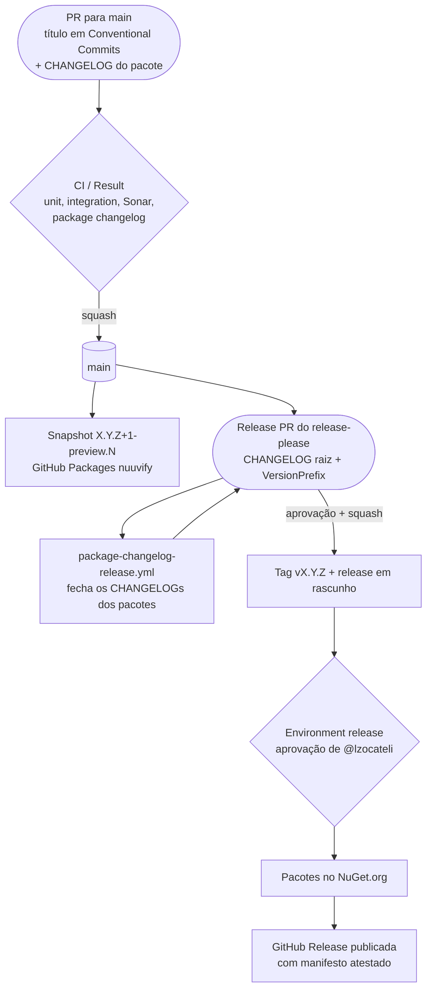

# Processo de release

O Nuuvify.CommonPack usa o processo único de CI/CD distribuído pelo
[Altivy.Groundwork](https://github.com/altivy-it/altivy-groundwork): Conventional Commits,
Release PR do release-please, tag única `vX.Y.Z` criada pelo GitHub App de release e publicação
no Environment `release`. O passo a passo genérico está em
[docs/runbooks/release.md](../runbooks/release.md) e os workflows em
[.github/CI-CD.md](../../.github/CI-CD.md). Este documento descreve apenas o que é específico
deste repositório: versão compartilhada, canais de publicação e CHANGELOG por pacote.

## Visão geral



## Versão compartilhada

- Os pacotes compartilham uma única versão: `VersionPrefix` em
  [src/Directory.Build.props](../../src/Directory.Build.props). Nunca altere esse valor à mão:
  o release-please atualiza o arquivo e o `.release-please-manifest.json` no Release PR.
- `AssemblyVersion` continua `Major.0.0.0` e `FileVersion` recebe a revisão do build.
- O tipo do título do PR define o incremento: `feat` → minor; `fix`, `perf`, `revert` e `deps`
  → patch; `!` ou rodapé `BREAKING CHANGE:` → major. Os demais tipos não geram release.

## Canais de publicação

| Canal | Quando | Versão | Destino | Environment |
| --- | --- | --- | --- | --- |
| Snapshot | Cada push na `main` (job `Snapshot` do CI) | `X.Y.(Z+1)-preview.N` | GitHub Packages da organização `nuuvify` | `preview` |
| Estável | Merge do Release PR | `X.Y.Z` | NuGet.org | `release` (com aprovação) |

- O secret `NUGET_API_KEY` precisa existir no Environment `release`. Snapshots usam apenas o
  `GITHUB_TOKEN` do job.
- Para consumir snapshots, adicione o feed `https://nuget.pkg.github.com/nuuvify/index.json`
  com um token que tenha `read:packages`. Snapshots não geram tag nem GitHub Release.
- As branches `qas` e `nugettest/qas` e os Environments `production` e `nugettest` não fazem
  mais parte do fluxo. O script local [CreatePack.ps1](../../tools/scripts/CreatePack.ps1)
  continua disponível para testes manuais no NuGet de homologação.

## CHANGELOG por pacote

O CHANGELOG raiz é gerado pelo release-please a partir dos títulos dos PRs e não deve ser
editado à mão. Cada pacote mantém o próprio `src/<Pacote>/CHANGELOG.md`, embarcado no `.nupkg`,
com o processo local abaixo:

| Etapa | Mecanismo | Momento |
| --- | --- | --- |
| Registro | O PR que altera `src/<Pacote>/**/*.cs` ou `*.csproj` adiciona itens em `## [Não Lançado]` de `src/<Pacote>/CHANGELOG.md` | PR de código |
| Gate | Job `Package changelog` ([package-changelog.yml](../../.github/workflows/package-changelog.yml)) roda [Test-PackageChangelogs.ps1](../../tools/scripts/Test-PackageChangelogs.ps1) e entra no `Result` do CI | `pull_request` |
| Fechamento | [package-changelog-release.yml](../../.github/workflows/package-changelog-release.yml) roda [Update-PackageChangelogs.ps1](../../tools/scripts/Update-PackageChangelogs.ps1) no Release PR e faz commit com o token do App | Abertura e atualização do Release PR |
| Idempotência | Pacotes que já têm a seção da versão são ignorados; se o release-please refizer a branch, o evento `synchronize` reaplica o fechamento | Toda atualização do Release PR |

O fechamento renomeia `## [Não Lançado]` para `## [X.Y.Z] - AAAA-MM-DD` (data UTC), remove
subseções vazias e recria `## [Não Lançado]` vazia. Pacotes sem itens não recebem seção de versão.

Para conferir localmente, a partir da raiz do repositório:

```powershell
./tools/scripts/Test-PackageChangelogs.ps1 -BaseRef origin/main
./tools/scripts/Update-PackageChangelogs.ps1 -Version 2.10.0 --dry-run
```

## Lançar uma versão

1. Faça o merge dos PRs com títulos em Conventional Commits. O release-please abre ou atualiza o
   Release PR `chore(main): release X.Y.Z`.
2. Revise o Release PR:
   - versão proposta e `VersionPrefix` em `src/Directory.Build.props`;
   - seção gerada no `CHANGELOG.md` raiz;
   - commit `docs: feche os CHANGELOGs dos pacotes na versão X.Y.Z` e os pacotes fechados.
3. Aprove e faça squash do Release PR quando o `Result` estiver verde.
4. O workflow `Release` cria a tag e a release em rascunho e chama o `publish.yml`.
5. Aprove o deployment no Environment `release`. Os pacotes vão para o NuGet.org com
   `--skip-duplicate`; a release é publicada com o manifesto atestado.
6. Confira os pacotes no NuGet.org; a indexação pode levar alguns minutos.

Para corrigir a versão proposta, lançar sem commit releasable, republicar pacotes ausentes ou
tratar uma release defeituosa, siga o [runbook de release](../runbooks/release.md).

## Falhas específicas

| Sintoma | Ação |
| --- | --- |
| `Package changelog` falha no PR | Atualize `## [Não Lançado]` de cada pacote listado na mensagem |
| Release PR sem o commit de fechamento | Confira a execução de `Package changelog release`; para reaplicar, feche e reabra o Release PR |
| `Publish packages` falha com credencial ausente | Crie ou renove `NUGET_API_KEY` no Environment `release` e republique pela seção 4 do runbook |
| Versão já existente no NuGet.org | O push é ignorado (`--skip-duplicate`); versões publicadas são imutáveis, então corrija com um patch |
